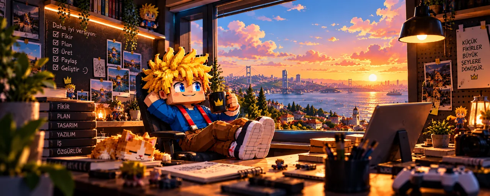
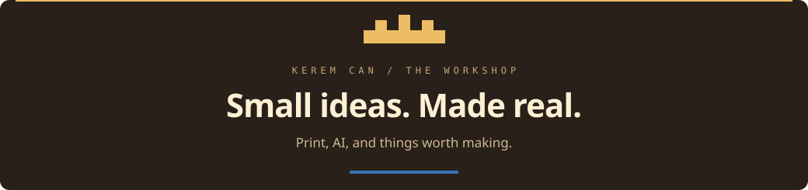
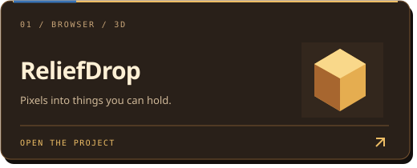
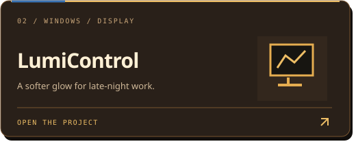
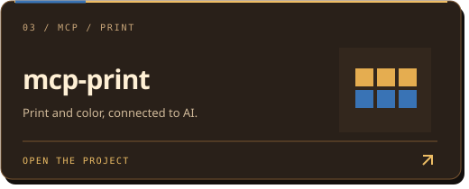
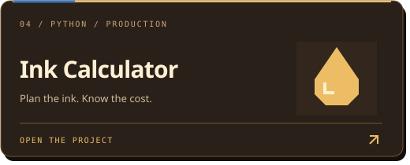
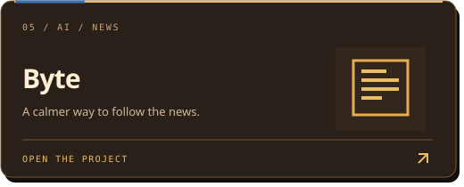
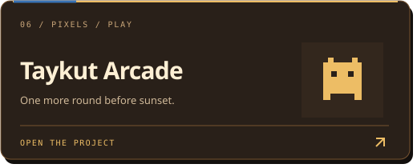

 

 

I build tools for **print, computer vision, and AI** — with a soft spot for pixels and side projects.

[**Visit the studio ↗**](https://keremcan.org) &nbsp; · &nbsp; [**Explore the work ↗**](https://github.com/kcgdz?tab=repositories)

 

---

 

### From the workbench

Six projects. One curious workshop.

<table>
<tr>
<td width="50%"></td>
<td width="50%"></td>
</tr>
<tr>
<td width="50%"></td>
<td width="50%"></td>
</tr>
<tr>
<td width="50%"></td>
<td width="50%"></td>
</tr>
</table>

  

THE WAY I WORK

### Notice something. Try something. Make it better.

The best projects usually start with a small inconvenience, 
a sketch on the desk, or a question worth following.

 

A slower moment in the workshop ☀️

 

  
No rush. Just keep making.

  

---

 

**Have something in mind?**

[Come say hello ↗](https://keremcan.org)

 

Stay curious. Make useful things. Enjoy the process.

