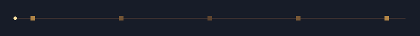
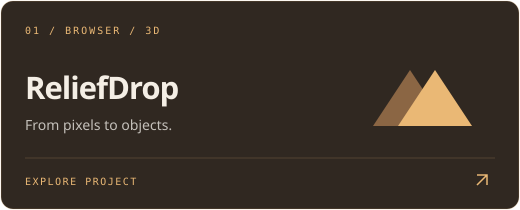
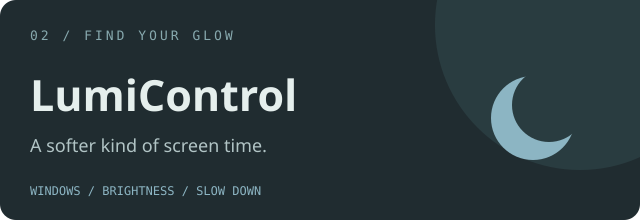

 

K E R E M &nbsp; C A N &nbsp; / &nbsp; T H E &nbsp; W O R K S H O P

# Good light. Small ideas. Real things.

A little print. A little AI. A lot of “what if?”

I’m Kerem — I build useful tools and leave room for play.

 

&nbsp;

 

IMAGINE &nbsp; / &nbsp; MAKE &nbsp; / &nbsp; SHARE &nbsp; / &nbsp; REPEAT

  

### A few things from my desk

Tools for real work. Experiments for the fun of it.

<table>
<tr>
<td width="50%" valign="top">

Images into layered 3D logos, stamps, keychains and reliefs. Right in your browser.

[Take a look ↗](https://github.com/kcgdz/ReliefDrop)

</td>
<td width="50%" valign="top">

Comfortable monitor brightness, smooth controls and saved setups for Windows.

[Take a look ↗](https://github.com/kcgdz/LumiControl)

</td>
</tr>
</table>

 

| Also on the workbench | |
| :--- | :--- |
| [**mcp-print ↗**](https://github.com/kcgdz/mcp-print) | Where print & color meet AI workflows. |
| [**Ink Calculator ↗**](https://github.com/kcgdz/ink-calculator) | A clearer estimate for your next print run. |
| [**Byte ↗**](https://github.com/kcgdz/byte) | A little order in the daily news stream. |
| [**Taykut Arcade ↗**](https://github.com/kcgdz/taykut-arcade) | Pixels, nostalgia, and one more round. |

 

### Somewhere between a sketch and a working prototype.

That’s my favorite place to be.

 

Pull up a chair ☀️

 

  
Small ideas grow into great things. No rush. Just keep making.

  

PRINT & COLOR &nbsp; · &nbsp; COMPUTER VISION & AI &nbsp; · &nbsp; CREATIVE TOOLS

  

[**Got a small idea? ↗**](https://keremcan.org)

Make yourself at home.

