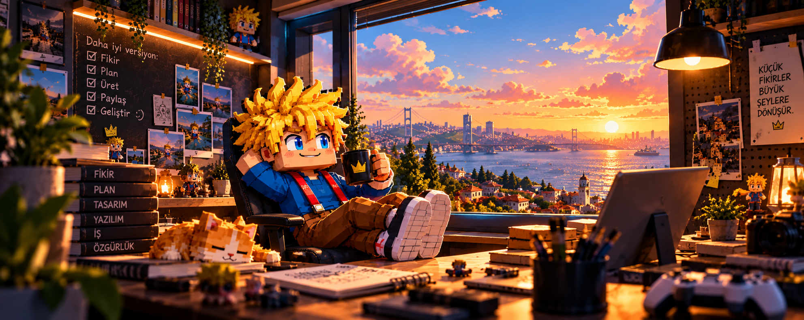
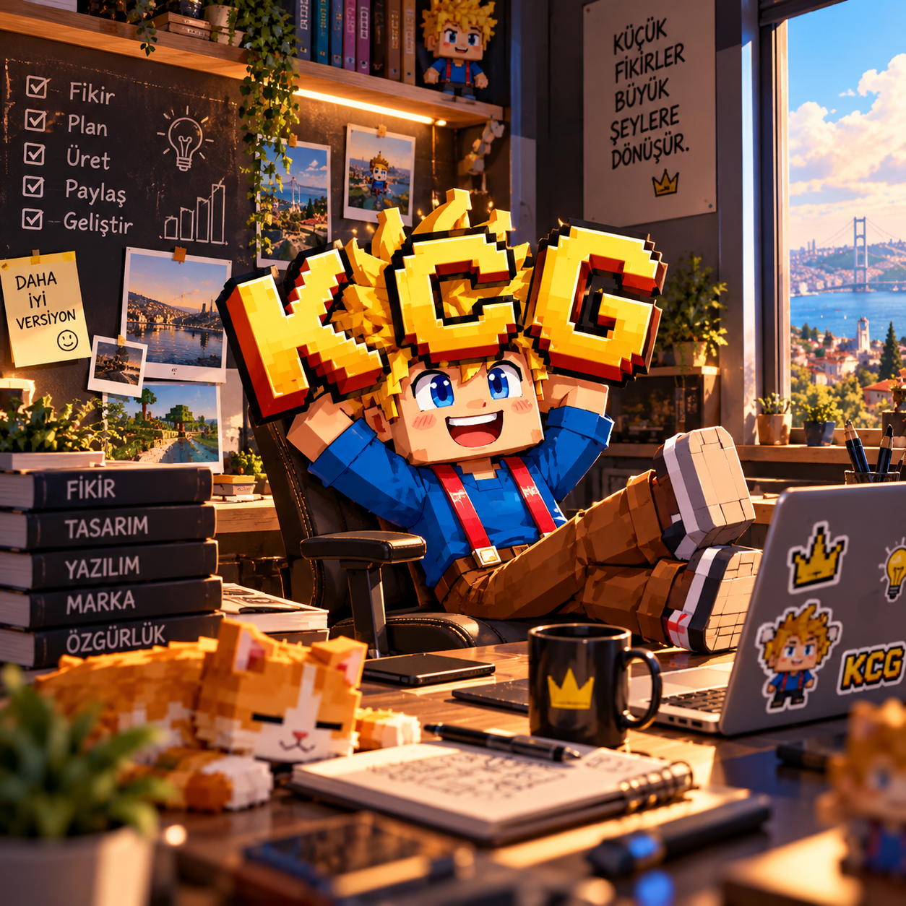

# Hey, I'm Kerem Can 👋

### Small ideas. Useful tools. A better version, every day.

I explore the intersection of **printing, computer vision & AI** — and build tools that make everyday work a little easier.

**Imagine → Plan → Build → Share → Improve**

---

## Welcome to my workshop

A place for practical experiments, creative side projects, and tools that earn their place on your desktop. My projects move between print production, AI workflows, browser tools, and playful interfaces.

I like turning a small “what if?” into something you can actually use.

## Things I've been building

| Project | What it does |
| :--- | :--- |
| [**ReliefDrop**](https://github.com/kcgdz/ReliefDrop) | Turn images into layered 3D logos, keychains, stamps and reliefs in your browser. |
| [**LumiControl**](https://github.com/kcgdz/LumiControl) | Comfortable brightness for Windows monitors, with smooth sliders and saved setups. |
| [**Ink Calculator**](https://github.com/kcgdz/ink-calculator) | Estimate print-run ink consumption and custom mixture costs. |
| [**mcp-print**](https://github.com/kcgdz/mcp-print) | Connect AI workflows with print and color tools through MCP. |
| [**Byte**](https://github.com/kcgdz/byte) | Collect, summarize and categorize RSS news with AI. |
| [**Taykut Arcade**](https://github.com/kcgdz/taykut-arcade) | A playful corner of the workshop: retro pixel art and arcade nostalgia. |

## The thread that connects it all

**Print & color** · Production tools with a practical purpose.  
**AI & automation** · Less repetitive work, more room for ideas.  
**Creative software** · Useful tools with a little personality.

---

<b>Step inside the workshop ☀️</b>

 

<i>Small ideas grow into great things.</i>

### Have an idea? Let's make something useful.

Explore a project, try it out, or open an issue with your feedback.

[**keremcan.org ↗**](https://keremcan.org)

